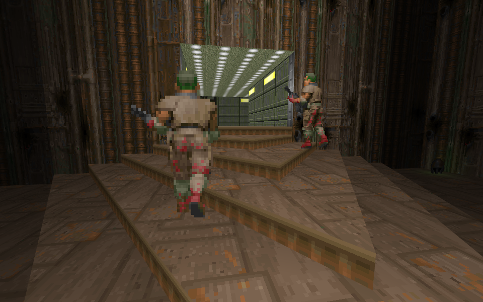
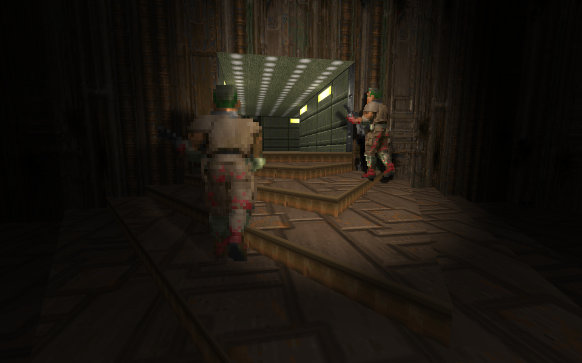
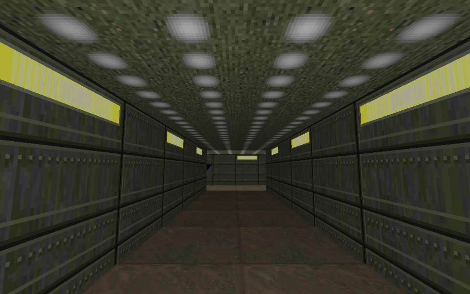
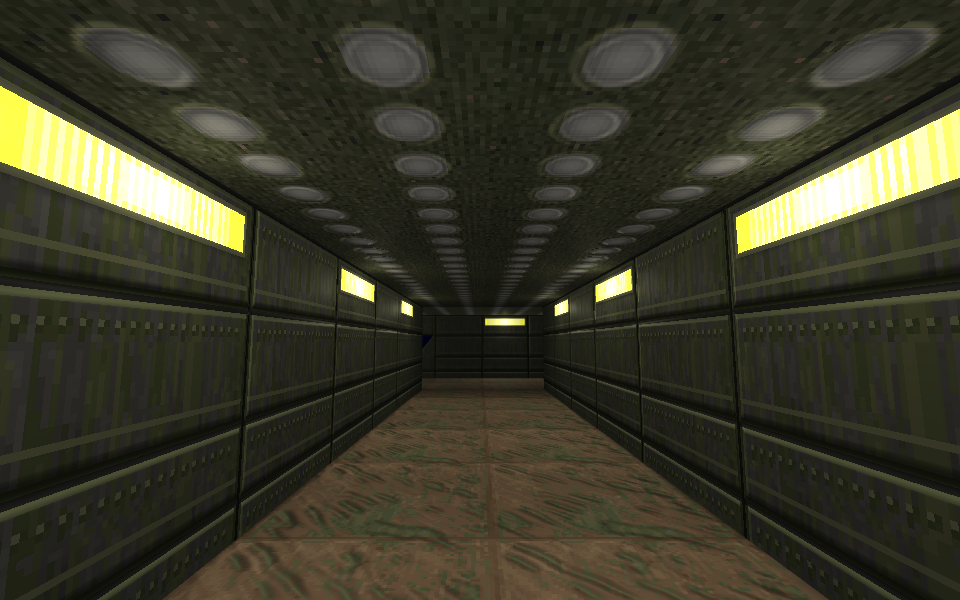
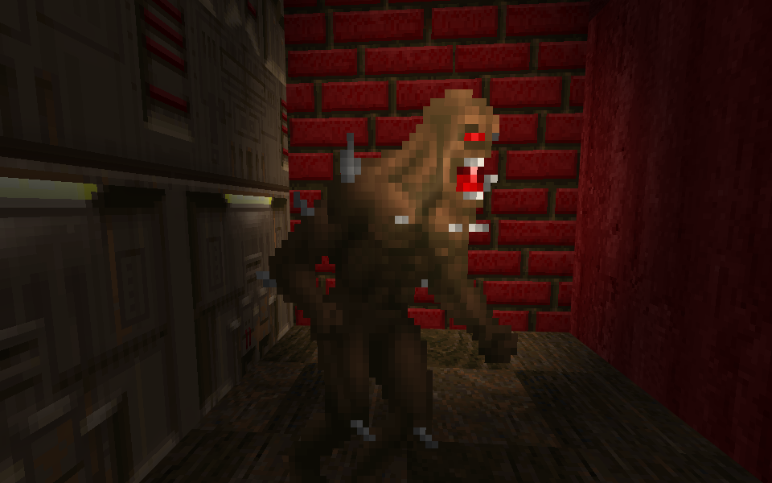
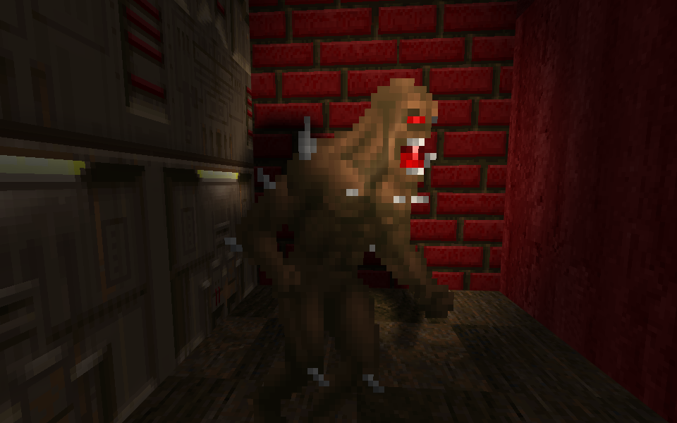

# Doom2OO3

A stripped-down, **playable** Vulkan Doom II remaster foundation. The visual target is the imagined ultimate 2003 remaster: original crisp Doom art, evocative normal/PBR materials, powerful local lights, a configurable flashlight, and convincing dynamically lit shadows.

## Doom II in-game comparisons

These captures preview the changes in [PR #6 for materials and lighting](https://github.com/techronomicon-labs/Doom2OO3/pull/6) and [PR #7 for flashlight shadows](https://github.com/techronomicon-labs/Doom2OO3/pull/7).

### Entryway (MAP01)

| A · Stock assets and sector lighting | B · PBR relief, emitters and flashlight |
| --- | --- |
|  |  |

### Entryway corridor (MAP01)

| A · Sector lighting | B · Emitters with 38% ambient fill |
| --- | --- |
|  |  |

### The Factory (MAP12)

| A · Flashlight shadows off | B · Depth flashlight shadows |
| --- | --- |
|  |  |

Each pair uses the same camera and framing in the Vulkan build. The corridor keeps PBR materials enabled in both shots, and the Factory keeps the same flashlight and ambient settings.

**Exact foundation:** [ShadeDoomVK PR #195 merged commit](https://github.com/techrote/ShadeDoomVK/commit/2cc70f33295881f73c7460364c6fa8e4e546efb3). Production engine/shaders, renderer crash/correctness/performance fixes, bundled assets and the #190 material/flashlight generator are preserved from that commit. The later legacy issue programme and its multi-hour verification infrastructure are intentionally *not* part of this checkout. The Git history remains available for targeted recovery.

This is a clean implementation starting point, **not** a claim that dynamic actor shadows were finished in #195. The engine executable is still named `vkdoom`, and internal `ShadeDoomVK` build-identity strings are retained rather than risk breaking a proven runtime.

## Windows build

Open **Visual Studio 2022 Developer PowerShell** (Desktop development with C++, x64 Windows SDK) in the repository root:

```powershell
cmake -S . -B build/windows -G "Visual Studio 17 2022" -A x64 -DPK3_QUIET_ZIPDIR=ON
cmake --build build/windows --config RelWithDebInfo --parallel 4
& .\build\windows\RelWithDebInfo\vkdoom.exe --version
```

Play with the Doom II WAD in `assets/wads`:

```powershell
& .\build\windows\RelWithDebInfo\vkdoom.exe -iwad ".\assets\wads\doom2.wad"
```

## Original procedural PBR and flashlight (#190)

Generate opt-in local materials (Python 3.11+, NumPy and Pillow):

```powershell
py -m pip install numpy pillow
py tools/doom2_showcase/build.py --doom2 ".\assets\wads\doom2.wad" --out ".\build\addons"
.\tools\doom2_showcase\launch.ps1 -Game DoomII -Exe ".\build\windows\RelWithDebInfo\vkdoom.exe" -Doom2 ".\assets\wads\doom2.wad" -Packages ".\build\addons"
```

Add `--dbp50 ".\assets\wads\DBP50.wad"` to build the DBP50 add-ons, or `--gallery` to build the material gallery. Use a fresh `--out` directory for each build. The generator checks the WAD hashes against the versions it supports.

Press **L** for the flashlight, **J** to cycle Off, Stencil and Depth shadows, and **O** for flashlight settings. Enemies and solid decorations cast in both campaigns. [Flashlight shadow controls](docs/SHADOW_PUPPETS.md) · [Build instructions](docs/BUILDING.md)

See the [Stage A relief evaluation](docs/RELIEF.md) for the opt-in Doom II and DBP50 material packs, Windows playtest controls and matched Vulkan captures.

See the [Stage B emitter lighting evaluation](docs/EMITTER_LIGHTING.md) for lighting comparisons in Doom II Entryway and the indoor and outdoor rooms.

## What is preserved / what is gone

- **Preserved:** unmodified PR #195 engine/CMake source, shaders, tools required for compilation, original game resource packages, GPL/third-party licensing, and `tools/doom2_showcase/` including its flashlight, procedural material maps and gallery.
- **Removed from the working tree:** historical PF/SDVK programme documents, RAG/ledger and issue graph, multi-hour renderer-oracle/physical-forensic harnesses, obsolete checkers, and legacy CI.
- **New lightweight validation:** one Windows compile/boot-identity/flashlight smoke workflow. Real graphical quality requires owner playtesting; no synthetic showcase can substitute for it.

## Implementation priority

Ship visible results first, with correctness safeguards. Actor shadows must affect the *right light* on real scene receivers; an easy floor-darkening decal is not an acceptable replacement. Follow [AGENTS.md](AGENTS.md) rather than any old ShadeDoomVK planning document found in Git history.

Licensed under GPL-3.0 with retained upstream and third-party notices. See `LICENSE` and `docs/licenses/`.
